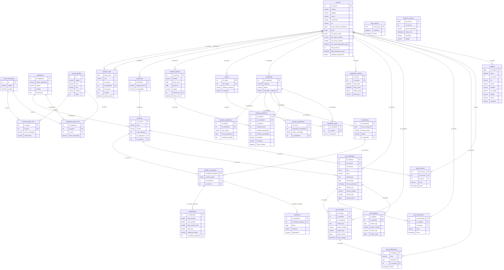

# Diagrama entidad-relación de SIGE

Generado automáticamente a partir de los scripts SQL del proyecto (`sql/`) y del Aula virtual (repositorio `sige-aula`). Contiene **30 tablas** y **37 relaciones** (claves foráneas).

Versión vectorial para ampliar sin perder calidad: [er.svg](er.svg). Código fuente del diagrama (Mermaid): [er.mmd](er.mmd).

## Grupos de tablas

- **Cuentas y seguridad:** `usuarios`, `controlador_sesiones`, `sesiones_web`, `bitacora_accesos`, `auditoria`.
- **Personas por rol:** `estudiantes`, `profesores`, `padres`, `estudiante_padre`.
- **Currículo:** `curriculo_grados`, `areas_curriculares`, `curriculo_grado_area`, `asignaturas`, `asignatura_grado_area`.
- **Operación académica:** `secciones`, `inscripciones`, `detalle_inscripciones`, `calificaciones`, `asistencias`.
- **Períodos e historial (Fase D):** `periodos_lectivos`, `historial_academico`, `records_academicos`, `reportes_academicos`.
- **Aula virtual:** `aula_materiales`, `aula_entregas`, `aula_archivos`, `aula_adjuntos`, `aula_calificaciones`, `aula_anuncios`, `aula_comentarios`.

## Reglas de integridad importantes

- Una nota (`calificaciones`) pertenece a una matrícula de materia (`detalle_inscripciones`), que une una inscripción con una sección.
- `periodos_lectivos.estado` solo admite `ABIERTO` o `CERRADO`; un período cerrado bloquea notas y matrículas.
- `historial_academico` tiene un único registro por estudiante y período.
- `auditoria` solo se escribe (la aplicación nunca la edita ni la borra) y guarda quién, qué, cuándo, por qué y el resultado (`OK` o `DENEGADO`).

## Tablas, llaves primarias y foráneas

| Tabla | Columnas | Llave primaria | Llaves foráneas |
|---|---|---|---|
| `areas_curriculares` | 3 | id | — |
| `asignatura_grado_area` | 4 | id_asignatura, id_grado | id_asignatura→asignaturas, id_grado→curriculo_grados, id_area→areas_curriculares |
| `asignaturas` | 5 | id_asignatura | — |
| `asistencias` | 5 | id_asistencia | id_detalle_inscripcion→detalle_inscripciones |
| `auditoria` | 10 | id_auditoria | id_usuario→usuarios |
| `aula_adjuntos` | 6 | id_adjunto | id_material→aula_materiales |
| `aula_anuncios` | 5 | id_anuncio | id_seccion→secciones, id_autor→usuarios |
| `aula_archivos` | 3 | archivo_key | — |
| `aula_calificaciones` | 5 | id_entrega | id_entrega→aula_entregas, id_profesor→usuarios |
| `aula_comentarios` | 5 | id_comentario | id_material→aula_materiales, id_usuario→usuarios |
| `aula_entregas` | 8 | id_entrega | id_material→aula_materiales, id_estudiante→usuarios |
| `aula_materiales` | 12 | id_material | id_seccion→secciones, id_profesor→usuarios |
| `bitacora_accesos` | 6 | id_acceso | — |
| `calificaciones` | 7 | id_calificacion | id_detalle_inscripcion→detalle_inscripciones |
| `controlador_sesiones` | 6 | id_sesion | id_usuario→usuarios |
| `curriculo_grado_area` | 4 | id_area, id_grado | id_grado→curriculo_grados, id_area→areas_curriculares |
| `curriculo_grados` | 6 | id | — |
| `detalle_inscripciones` | 4 | id_detalle_inscripcion | id_inscripcion→inscripciones, id_seccion→secciones |
| `estudiante_padre` | 3 | id_estudiante, id_padre | id_estudiante→estudiantes, id_padre→padres |
| `estudiantes` | 4 | id_estudiante | id_estudiante→usuarios |
| `historial_academico` | 9 | id_historial | id_estudiante→estudiantes, id_periodo→periodos_lectivos |
| `inscripciones` | 5 | id_inscripcion | id_estudiante→estudiantes |
| `padres` | 4 | id_padre | id_usuario→usuarios |
| `periodos_lectivos` | 7 | id_periodo | cerrado_por→usuarios |
| `profesores` | 3 | id_profesor | id_profesor→usuarios |
| `records_academicos` | 4 | id_record | id_estudiante→estudiantes |
| `reportes_academicos` | 5 | id_reporte | id_estudiante→estudiantes |
| `secciones` | 6 | id_seccion | id_asignatura→asignaturas, id_profesor→profesores |
| `sesiones_web` | 7 | token_hash | id_usuario→usuarios, id_pendiente→usuarios |
| `usuarios` | 15 | id_usuario | — |
