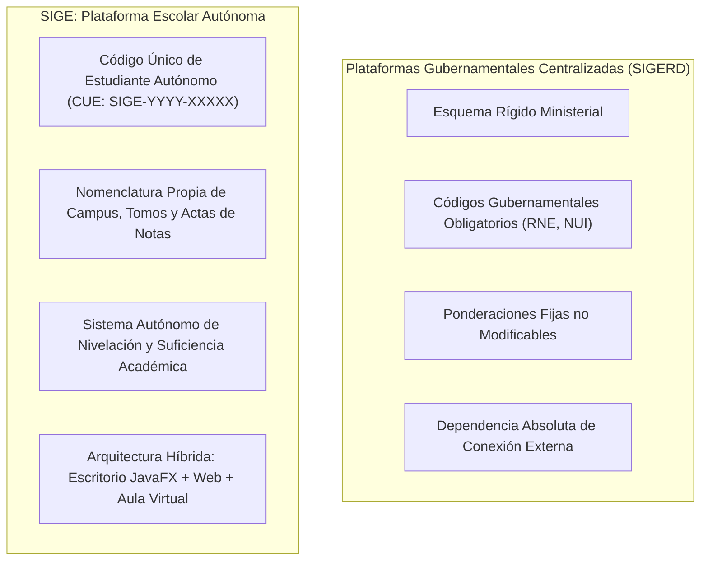

# Identidad y Diferenciación Institucional de SIGE

Este documento detalla los principios de diseño e independencia funcional de **SIGE**, destacando cómo la plataforma mantiene una identidad de producto propia y autónoma, diferenciándose conceptual y técnicamente de los sistemas gubernamentales centralizados (como SIGERD).

---

## 1. Principios de Independencia de la Plataforma

---

## 2. Diferenciadores Específicos Implementados

### A. Identificadores Institucionales Propios (`IdentificadorEscolar.java`)
- **En lugar de códigos ministeriales fijos (RNE):** SIGE implementa el **Código Único de Estudiante (CUE)** con formato institucional:
  $$\text{SIGE-YYYY-XXXXX} \quad (\text{ej. SIGE-2026-00042})$$
- Admite matrículas internas de colegios privados o instituciones universitarias (ej. `UNEV-2026-0100`, `ST-2026-0042`) y códigos de catálogo de asignaturas modulares (`SIGE-MAT-101`).

### B. Certificación y Récord de Calificaciones Autónomo (`ValidadorActaCalificaciones.java`)
- Estructura de registro basada en Tomo, Página y Código de Acta Institucional con firma/código de seguridad verificador (`ACT-XXXXXX`), brindando trazabilidad interna a la secretaría del centro sin subordinación a sellos de distritos externos.

### C. Sistema de Nivelación y Segunda Oportunidad (`CalculoRecuperacion.java`)
- Reemplaza esquemas rígidos por un **modelo configurable de nivelación**:
  1. **Nivelación Compuesta:** 40% trabajo continuo $+ 60\%$ evaluación de síntesis.
  2. **Suficiencia Integral:** 100% prueba de reposición para materias validadas por suficiencia.
  3. **Ponderación Equilibrada:** 50% ordinario $+ 50\%$ recuperación.

### D. Perfil de Campus y Sedes Institucionales (`ValidadorCentroEducativo.java`)
- Modelo enfocado en el centro escolar privado o universitario: Código de Campus/Sede, Siglas de la Entidad y Modalidades curriculares internas (Bilingüe, Técnico, General), utilizando únicamente el RNC legal del contribuyente.

### E. Programa de Vinculación Comunitaria y Horas Sociales (`ControlServicioSocial.java`)
- Permite a la institución configurar la meta horaria deseada (60, 80 o 120 horas) según el reglamento y perfil de egreso propio de la escuela o universidad.

---

## 3. Conclusión de Autonomía de Producto

SIGE está concebido como un **sistema de gestión institucional privado y flexible**. No es una copia ni un clon de la plataforma estatal; cuenta con su propia identidad gráfica, arquitectura híbrida (JavaFX + Web), aula virtual desacoplada con SSO y esquemas de evaluación configurables para centros educativos independientes.
